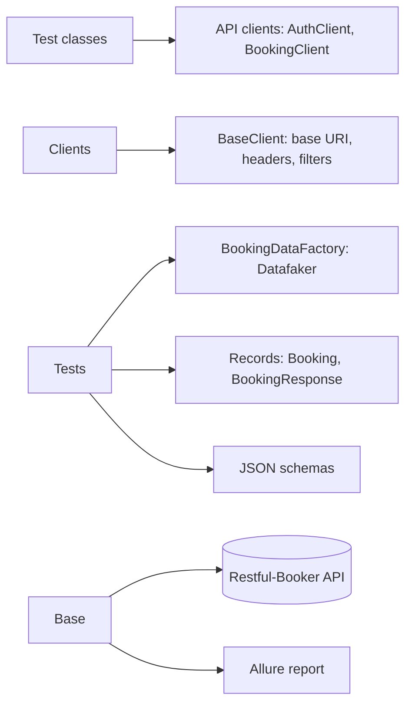

# REST Assured API Automation Framework

!\[API Tests](https://github.com/akhileshntech/restassured-api-framework/actions/workflows/api-tests.yml/badge.svg)

An API test framework for the public [Restful-Booker](https://restful-booker.herokuapp.com/apidoc/index.html) service, built with **Java 17, REST Assured, TestNG and Maven**. It uses a client-layer design, typed request/response models, JSON schema validation and generated test data. CI publishes a live **Allure report** with every request and response attached.

**Live report:** `https://akhileshntech.github.io/restassured-api-framework/` *(available after the first CI run on `main`)*

## Tech stack

|Area|Tool|
|-|-|
|Language / build|Java 17, Maven|
|API testing|REST Assured 5|
|Test runner|TestNG (groups, data providers, parallel classes)|
|Serialization|Jackson with Java records as models|
|Contract checks|JSON Schema validation|
|Test data|Datafaker|
|Reporting|Allure (requests and responses attached to each test)|
|CI/CD|GitHub Actions + GitHub Pages, Docker|

## Architecture



```
src/test
├── java/com/sdet/api
│   ├── client/   BaseClient, AuthClient, BookingClient (one method per endpoint)
│   ├── config/   ApiConfig (-D flag > env var > config.properties)
│   ├── models/   Booking, BookingDates, BookingResponse (records)
│   ├── utils/    BookingDataFactory
│   └── tests/    BaseApiTest, AuthTests, BookingCrudTests, BookingNegativeTests
└── resources
    ├── config.properties
    ├── schemas/  booking-schema.json, create-booking-response-schema.json
    ├── testng.xml
    └── smoke.xml
```

## Key design decisions

* **Client layer:** tests never build raw HTTP calls. Clients return the raw `Response`, so tests can assert on negative cases too.
* **Independent tests:** every test creates its own booking, so there is no ordering dependency and the suite runs in parallel safely.
* **Contract + behaviour:** schema validation checks the shape of responses, and field-level assertions check the values.
* **Generated data:** Datafaker produces unique bookings, so there are no hard-coded records to collide.
* **Failure-only console logging:** the full request and response are logged only when a validation fails. Allure always has them.
* **Documented API quirks:** Restful-Booker returns `200` for bad credentials and `201` for DELETE. Tests assert the real behaviour and say so in comments.

## Endpoint coverage

|Endpoint|Scenarios|
|-|-|
|`POST /auth`|valid login returns token; invalid credentials rejected (data-driven)|
|`POST /booking`|create + contract check + response time; stored data equals request|
|`GET /booking`|list returns ids|
|`GET /booking/{id}`|returns created booking + contract check; unknown id gives 404|
|`PUT /booking/{id}`|full update persisted; no token gives 403|
|`PATCH /booking/{id}`|only supplied fields change|
|`DELETE /booking/{id}`|booking removed (201 then 404); invalid token gives 403|

## Run it

Prerequisites: JDK 17+, Maven 3.9+.

```bash
mvn clean test                                          # full suite
mvn clean test -DsuiteFile=src/test/resources/smoke.xml # smoke only
mvn clean test -DbaseUrl=https://your-other-env.example # point at another environment
mvn allure:serve                                        # open the report locally
docker build -t api-tests . \&\& docker run --rm api-tests
```

> Restful-Booker is a shared public practice API. It can be slow, and its data resets periodically. If a run fails on connectivity, retry before assuming a framework bug.

## CI/CD

`.github/workflows/api-tests.yml` runs on every push and pull request, nightly, and on demand. It builds the Allure report and deploys it to GitHub Pages from `main`.

One-time setup: **Settings → Pages → Build and deployment → Source: GitHub Actions**.

## What I would add next

* \[ ] Auth-token caching across test classes
* \[ ] Contract tests with Pact
* \[ ] Database validation for the booking flow

## Author

**Akhilesh N: QA Automation Engineer · \[LinkedIn]**

**(https://www.linkedin.com/in/akhilesh-n-7775a021b)**

